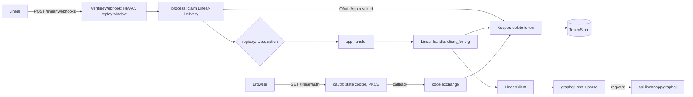

# Planning — autumn-plugin-linear

## Goal

Give an Autumn app a safe, general Linear integration:

- Receive signed Linear webhooks and route them by type and action.
- Install the app on a Linear workspace with OAuth and keep its token fresh.
- Call the Linear GraphQL API with rate-limit-aware retries.

The long-term use case is Linear as the issue intake layer for a mesh of
agents. The plugin stays general. The design keeps these needs in view:

- Fast acknowledgement (Linear waits 5 s) and a durable hand-off.
- Idempotent write-back (comments, issue updates, agent activities).
- One tenant key on every event (`organizationId`).
- Agent session events and agent activities as first-class data.
- GraphQL operations that any transport can carry (reqwest, the San Mateo
  proxy, a camel route).

The shape follows `autumn-plugin-shopify`: a config section, an
`on_startup` hook, routes under one prefix, a health indicator, typed
errors, and store traits with in-memory defaults.

## Grounding (2026-11-01)

Checked on linear.app/developers and the Linear SDK schema
(`linear/linear`, `packages/sdk/src/schema.graphql`). Autumn facts come
from the `autumn-web-0.9.0` sources.

| Fact | Source |
|---|---|
| Webhook headers: `Linear-Delivery` (UUID v4 per payload), `Linear-Event` (entity type), `Linear-Signature`, `Linear-Timestamp` (ms), `User-Agent: Linear-Webhook`. | developers, "Webhooks" |
| Signature: hex HMAC-SHA256 of the raw body, key = webhook signing secret. Compare in constant time. | same |
| Replay: body field `webhookTimestamp` (Unix ms). Reject when more than 60 s from now. | same |
| Success is HTTP 200 within 5000 ms. Up to 3 retries: after 1 min, 1 h, 6 h. Linear can disable a failing webhook. | same |
| Envelope fields: `action`, `type`, `actor`, `createdAt`, `data`, `url`, `updatedFrom`, `organizationId`, `webhookId`, `webhookTimestamp`. | same; schema `EntityWebhookPayload` |
| `OAuthApp` `revoked` payload: `oauthClientId`, `organizationId`, `createdAt: DateTime!` (the same on each retry). | developers; schema `OAuthAppWebhookPayload` |
| `AgentSessionEvent` payload: `action` (`created`, `prompted`), `agentSession`, `agentActivity` (`content`, `signal`), `promptContext`, `guidance`, `previousComments`, `appUserId`, `oauthClientId`. | developers, "Agent interaction"; schema |
| A `created` agent session needs an activity or an external URL within 10 s. | developers, "Agent interaction" |
| The prompt text: the docs say `agentActivity.body`; the schema has `agentActivity.content.body`. The plugin reads both. | "Agent interaction"; schema `AgentActivityWebhookPayload` |
| `agentSessionUpdate(id, input: {addedExternalUrls: [{label, url}]})`. | schema `AgentSessionUpdateInput`, `AgentSessionExternalUrlInput` |
| `comments(filter: {id: {eq: ID}}, first: 1)` finds a comment by id. `comment(id)` returns `Comment!`, so a missing id is an error. | schema `CommentFilter`, `IDComparator`, `Query.comment` |
| `issueCreate` and `agentActivityCreate` also take an optional `id` (UUID v4 format). | schema `IssueCreateInput`, `AgentActivityCreateInput` |
| Rate-limit reset headers are UTC epoch ms: `X-RateLimit-Requests-Reset`. | developers, "Rate limiting" |
| Activity types: `thought`, `elicitation`, `action`, `response`, `error` (`prompt` is user-only). Signals: `auth`, `continue`, `select`, `stop`. A `stop` signal means no more actions. | schema `AgentActivityType`, `AgentActivitySignal`; "Agent signals" |
| `agentActivityCreate(input: {agentSessionId, content, signal, ephemeral, id})`. | schema |
| GraphQL endpoint `https://api.linear.app/graphql`. API key: `Authorization: <key>`. OAuth: `Authorization: Bearer <token>`. | developers, "GraphQL" |
| Errors come in `errors[]` with `message` and `extensions`. HTTP 200 can carry partial data and errors. | same |
| Rate limit: HTTP 429, `extensions.code = RATELIMITED`, `Retry-After` in seconds. Headers `X-RateLimit-*` (reset in ms). | developers, "Rate limiting" |
| Pagination: `first`/`after`, `pageInfo { hasNextPage endCursor }`, `nodes`. Default page 50. | developers, "Pagination" |
| `issue(id)` takes a UUID or an identifier such as `ENG-123` (the page shows `issue(id: "BLA-123")`). | developers, "GraphQL" |
| `commentCreate(input: {issueId, body, id, parentId})`. `id` is optional and client-chosen. | schema `CommentCreateInput` |
| `issueUpdate(id, input: {stateId, priority, assigneeId, delegateId, addedLabelIds, removedLabelIds, ...})`. | schema `IssueUpdateInput` |
| `webhookCreate(input: {url, resourceTypes, teamId, allPublicTeams, secret, label})`, `webhookDelete(id)`. Needs `admin`. | schema; developers, "Webhooks" |
| OAuth authorize `https://linear.app/oauth/authorize`: `client_id`, `redirect_uri`, `response_type=code`, `scope` (comma-separated), `state`, `prompt=consent`, `actor=user\|app`, PKCE `code_challenge` + `code_challenge_method=S256`. | developers, "OAuth 2.0" |
| Token `POST https://api.linear.app/oauth/token`, form body. Code grant fields: `code`, `redirect_uri`, `client_id`, `client_secret`, `grant_type`, `code_verifier`. Response: `access_token`, `token_type`, `expires_in` (about 24 h), `scope`, `refresh_token`. | same |
| Refresh: `grant_type=refresh_token`. Each refresh rotates the pair. A refresh has a 30 min grace period. Since 2026-04-01 all apps use refresh tokens. | same |
| Scopes: `read`, `write`, `issues:create`, `comments:create`, `timeSchedule:write`, `admin`. The page names `app:assignable` and `app:mentionable` and documents them on the app page (not read). | same |
| `scope` in the token response is a string for apps from 2023-12-01 on, an array before. | same |
| Autumn `WebhookProvider::Generic` expects a `sha256=` prefix. It has no Linear preset and no body-timestamp check. | `autumn-web-0.9.0/src/webhook.rs` |
| `TestApp::plugin` runs plugin startup hooks. | `autumn-web-0.9.0/src/test.rs` |
| San Mateo has a built-in `linear` OAuth2 provider (proxy base `https://api.linear.app`). | `san-mateo/crates/san-mateo/providers/providers.yaml` |

Not stated by Linear, so the plugin does not depend on it:

- Whether a retry keeps the `Linear-Delivery` value. See ADR 0002.
- The token endpoint error codes. The plugin follows RFC 6749 section 5.2:
  `invalid_grant` means a dead grant; `invalid_client` means a bad app
  secret.
- That Linear does not run a rate-limited call. The plugin retries only an
  answer with no `data`.

## Brainstorming (what can the plugin do?)

1. HMAC verify extractor on raw bytes. **In.**
2. Replay window on the signed `webhookTimestamp`. **In.**
3. Router by `type` and optional `action`: `.on("Issue", h)`,
   `.on_action("Issue", "create", h)`. **In.**
4. Duplicate guard on `Linear-Delivery`. **In.**
5. Typed views: `Issue`, `Comment`, `AgentSession` event, `updatedFrom`
   helpers (`changed`, `label_added`). **In.**
6. Delete the stored token on `OAuthApp` `revoked`. **In.**
7. OAuth install, PKCE S256, `actor=app`, stateless state cookie. **In.**
8. Token refresh with rotation, one refresh per workspace. **In.**
9. `TokenStore` and `DeliveryStore` traits, in-memory defaults. **In.**
10. GraphQL client with typed `query::<T>()`, rate-limit retry. **In.**
11. Transport-free GraphQL operations (`graphql::ops`) and a response
    parser, so San Mateo or camel can carry them. **In.**
12. Helpers: viewer, organization, issue, issues page, create and update
    issue, create comment (client-chosen id), find comment, create agent
    activity, update agent session URLs, create and delete webhook. **In.**
13. API-key mode (one workspace) with a health indicator. **In.**
14. Test kit: sign a body, build a signed event at a time. **In.**
15. Secret rotation (`LINEAR_WEBHOOK_SECRET_PREVIOUS`). **In.**
16. A pure policy core with a Verus spec. **In.**
17. Ecosystem example: autumn + camel + harvest + San Mateo. **In.**
18. Client-credentials grant (app token, no refresh). Out (next).
19. Webhook IP allow list. Out: Linear does not publish the list in the
    webhook docs; an operator can filter at the edge.
20. Typed SDK for the full schema (codegen). Out: too large; `query::<T>`
    covers it.
21. Agent plan updates (technology preview). Out.
22. A database `TokenStore`. Out: the trait lets apps bring one.
23. Webhook auto-subscription at install. Out: `create_webhook` is there
    for the install handler.

## Reverse brainstorming (ways to make it fail)

| Way to fail | Counter-measure |
|---|---|
| Parse JSON, re-serialize, then check the HMAC. | The check runs on the raw bytes first. Test: a changed byte gives 401. |
| Compare digests with `==`. | `Mac::verify_slice` (constant time). Try every secret. |
| Replay a captured request an hour later. | Signed `webhookTimestamp` within 60 s (configurable, 1–600 s). Test: stale and future times give 401. |
| Trust the unsigned `Linear-Event` header for routing. | Route on the signed body `type`. Log a header that disagrees. |
| Run the handler two times for one delivery. | Claim on `Linear-Delivery`. Done gives 200, in flight gives 409. Apps get `entity_key()` for their own idempotency. |
| Ack before the work is safe; lose the event on a crash. | A handler returns `Ok` only after a durable hand-off. The example shows harvest. Errors give 500, so Linear retries. |
| A slow handler makes Linear time out and retry. | Docs: enqueue, then return. The handler runs in its own task, so a dropped request does not cancel it. |
| Retry a mutation after a 5xx; post a comment two times. | Retry only rate-limit answers (the request did not run). `create_comment` takes a client id. |
| Leak a token or secret in `Debug`, logs, or errors. | Redacted `Debug`; error bodies truncated; no token in errors. Tests. |
| Put secrets in `autumn.toml`. | A secret key in `[linear]` stops the startup. The error names the key only. |
| Follow a redirect that carries the token to another host. | The HTTP client follows no redirects. |
| CSRF on the OAuth callback; code injection. | State nonce in a `__Host-` cookie, constant-time compare; PKCE S256 with a verifier derived from the nonce. |
| Open redirect after install. | `after_install_path` must be a local path. |
| Two refreshes race and one loses the rotated pair. | One refresh per workspace in a task (survives caller cancel). Delete only when the store still holds the refused pair. |
| Revoked app keeps a token. | `OAuthApp` `revoked` deletes the token (not a newer install). |
| A webhook from tenant A acts on tenant B. | Every context carries the signed `organizationId`. `client_for(org)` uses that org. |
| A test base URL points production traffic at a stub. | `api_base_url` is test-only and must be loopback. |
| Unbounded memory in the delivery store. | Window, capacity, lease. |
| A panic in a handler leaves the claim in flight. | `catch_unwind`, then release. |

## Six thinking hats

- **White (facts).** See the grounding table. Linear signs the body only.
  Headers are not signed. Tokens last about 24 h. Rate limits are per
  user per hour. The 5 s budget is hard.
- **Red (feelings).** Webhook plugins feel easy and fail quietly. Users
  fear double comments from bots more than a missed one. Agent authors
  want a typed agent-session view, not raw JSON.
- **Black (risks).** Linear changes payload fields; strict structs break.
  Use optional fields and keep `data` raw. Delivery-id reuse on retry is
  not documented. The 60 s window fails on clock skew; make it
  configurable and use the app clock. Verus does not run in every dev
  box; CI runs it.
- **Yellow (benefits).** One `.plugin(...)` call gives signed, deduped,
  typed events with a tenant key. The transport-free operations let the
  same queries run through San Mateo, which holds tokens for many
  providers.
- **Green (ideas).** Derive the PKCE verifier from the nonce, so the
  flow stays stateless. Give `create_comment` a client id derived from the
  work key, so a retry is a no-op. Expose `promptContext` and the stop
  signal for agent loops.
- **Blue (process).** Spec the policy core first (Verus), then RED tests
  per module, then GREEN, then refactor. Review from five angles. Map each
  AC to evidence in `docs/acceptance.md`.

## Design

| Module | Owns |
|---|---|
| `error` | `Error`, `ErrorKind`, `status()`, `to_autumn_error()` |
| `types` | `OrganizationId`, `EventType`, `Action`, `Actor` |
| `policy` | Pure, verified decisions: replay window, refresh, retry, claim state |
| `verify` | `SecretSet`, hex HMAC sign and verify |
| `event` | `WebhookEvent` envelope and typed views |
| `config` | `LinearConfig`: `[linear]` + `LINEAR_*` |
| `delivery` | `DeliveryStore`, `InMemoryDeliveryStore` |
| `tokens` | `WorkspaceToken`, `TokenStore`, `InMemoryTokenStore` |
| `graphql` | `Operation`, `ops::*`, `parse_response`, typed nodes |
| `client` | `LinearClient`, `Credential`, `RetryPolicy` |
| `webhooks` | Route, `VerifiedWebhook`, `WebhookRegistry`, `process` |
| `oauth` | Install and callback routes, exchange, refresh |
| `health` | `LinearHealth` |
| `plugin` | `LinearPlugin`, `LinearRuntime`, `Keeper`, `Linear`, `InstallContext` |
| `testing` | `EventFixture`, `SignedEvent` (signing uses `verify::sign`) |

Routes: `POST /linear/webhooks`, `GET /linear/auth`,
`GET /linear/auth/callback`. All `#[public]`.

Two auth shapes:

- **API key (one workspace).** `LINEAR_API_KEY`. `client()` and
  `client_for(_)` use it while OAuth is off.
- **OAuth app (many workspaces).** `app_url`, `client_id`,
  `LINEAR_CLIENT_SECRET`, `scopes`. `client_for(&org)` uses the token
  store and refreshes.

## Acceptance criteria

### Config

- **AC-01** `[linear]` keys and defaults load; an unknown key fails.
- **AC-02** A secret key in `[linear]` fails. The error names the key and
  not the value.
- **AC-03** Secrets come only from the environment lookup
  (`LINEAR_WEBHOOK_SECRET`, `LINEAR_WEBHOOK_SECRET_PREVIOUS`,
  `LINEAR_CLIENT_SECRET`, `LINEAR_API_KEY`). `Debug` redacts them.
- **AC-04** Precedence: `configure` closures > environment > file >
  defaults. `env_lookup` replaces the process environment.
- **AC-05** `validate`: OAuth needs `client_id`, the client secret, at
  least one valid scope, and a valid `app_url`; `actor` is `user` or
  `app`; tolerance 1–600 s; retries 0–10; `after_install_path` is local;
  webhook handlers need a webhook secret.
- **AC-06** A bad config stops the startup.

### Types and policy

- **AC-07** `OrganizationId`, `EventType`, and `Action` parse with
  anchored rules and refuse hostile values.
- **AC-08** Replay window: fresh if and only if `|now - ts| <= tolerance`,
  with no overflow. Verus spec and property test.
- **AC-09** Refresh decision: refresh if and only if the token expires
  within the margin. Verus spec and property test.
- **AC-10** Retry decision: retry only a rate-limit answer, only while
  `attempt < max`; the wait is at most the cap. Verus spec and property
  test.
- **AC-11** Claim state machine: done stays done; in flight blocks until
  the lease ends; only the owning claim time can complete or release.
  Verus spec and tests.

### Webhook verification

- **AC-12** Hex HMAC-SHA256 on the raw body, constant time, previous
  secret accepted. Reference vector.
- **AC-13** Every signature failure gives 401, before any parsing.
- **AC-14** A stale, future, or missing `webhookTimestamp` gives 401.
- **AC-15** A body over 1 MiB gives 413.
- **AC-16** A missing `Linear-Delivery` or a body that is not an envelope
  gives 400. Routing uses the signed `type`, not `Linear-Event`.

### Webhook dispatch

- **AC-17** The `(type, action)` handler runs, else the `type` handler;
  the answer is 200.
- **AC-18** A handler error gives a non-2xx answer and releases the claim;
  the retry runs again.
- **AC-19** A done duplicate gives 200 and runs nothing; an in-flight one
  gives 409.
- **AC-20** An event with no handler gives 200 and runs nothing.
- **AC-21** A bad or repeated handler key stops the startup.
- **AC-22** `OAuthApp` `revoked` deletes the workspace token (not a newer
  install), then runs the handler.
- **AC-23** The handler runs in its own task. A dropped request does not
  stop it. A panic gives 500 and releases the claim.
- **AC-24** `WebhookContext` carries the event, delivery id, organization,
  raw body, state, and `Linear` handle; typed views and `updatedFrom`
  helpers work.
- **AC-25** `VerifiedWebhook` and `process` work on a custom route.
- **AC-26** The agent session view gives the session id, issue, prompt
  context, prompt body, and the stop signal.

### GraphQL and client

- **AC-27** `graphql::ops` build `{query, variables}` without IO, and
  `parse_response` reads data, errors, and rate limits.
- **AC-28** The client posts to `https://api.linear.app/graphql`. An API
  key goes raw in `Authorization`; an OAuth token goes as `Bearer`.
- **AC-29** GraphQL errors give `Error::GraphQl` with the messages, also
  next to partial data. HTTP errors keep the status and a truncated body.
- **AC-30** Only rate-limit answers retry (429 or `RATELIMITED`), with
  `Retry-After`, a capped wait, and a retry limit. A 5xx does not retry.
- **AC-31** Typed helpers work: viewer, organization, issue, issues page
  (`Connection<T>`), create and update issue, create comment with an id,
  find comment, create agent activity, update session URLs, create and
  delete webhook.
- **AC-32** No token in `Debug` or errors. No redirect is followed.

### OAuth

- **AC-33** Install redirects to the authorize URL with all parameters:
  comma scopes, `actor`, `state`, PKCE S256, and `prompt=consent`. It sets
  a `__Host-` state cookie (`HttpOnly`, `Secure`, `SameSite=Lax`, 10 min).
- **AC-34** The callback checks the state (403) and refuses an `error`
  answer. It exchanges the code with the verifier and reads the
  organization. It stores the token, runs the install handler, and
  redirects to a local path. An exchange failure gives 502 with no secret.
- **AC-35** `client_for` refreshes within the margin, one refresh per
  workspace at a time. It stores the rotated pair. A refused grant gives
  `Reauthorize` and deletes only an unchanged pair. A transient failure
  keeps a valid old token and starts a backoff.
- **AC-36** OAuth routes give 404 when OAuth is off.
- **AC-37** `TokenStore` is a trait with an in-memory default; the app can
  replace it.

### Plugin

- **AC-38** The plugin declares `[linear]`, mounts under `/linear`,
  declares the `autumn-web` contract, passes the conformance harness, and
  classifies its routes as public.
- **AC-39** The `Linear` extractor gives `client()`, `client_for(&org)`,
  and `install_url()`; it gives 503 without the runtime.
- **AC-40** API-key mode registers a health-only indicator.
- **AC-41** Startup warnings: CSRF blocks the webhook path; API key and
  OAuth both set.
- **AC-42** The test kit signs bodies and builds signed events that the
  plugin accepts.

### Examples

- **AC-43** `examples/triage_app.rs` builds, and a test runs its handler
  over HTTP.
- **AC-44** `examples/intake-desk` runs the full chain: signed webhook →
  plugin → camel `harvest:` → durable harvest workflow → activities →
  camel → San Mateo proxy (adds auth) → Linear GraphQL (fake). It checks
  its result, has failure tests, and runs in CI with Postgres.
- **AC-45** Repeated deliveries for one issue start one workflow and post
  one comment.

### Quality

- **AC-46** `cargo fmt`, clippy (pedantic, nursery, `-D warnings`), and
  MSRV 1.88 pass.
- **AC-47** Line coverage is 85 % or more.
- **AC-48** README, CLAUDE.md, ADRs, and CHANGELOG exist in ASD-STE100
  style. `missing_docs` is clean.
- **AC-49** The policy core has a Verus spec, a body-drift test, and a CI
  job that runs Verus.

## Not in this release

- Client-credentials tokens.
- Webhook source IP checks.
- Agent session plan updates.
- Autumn profile layering for `[linear]`.
